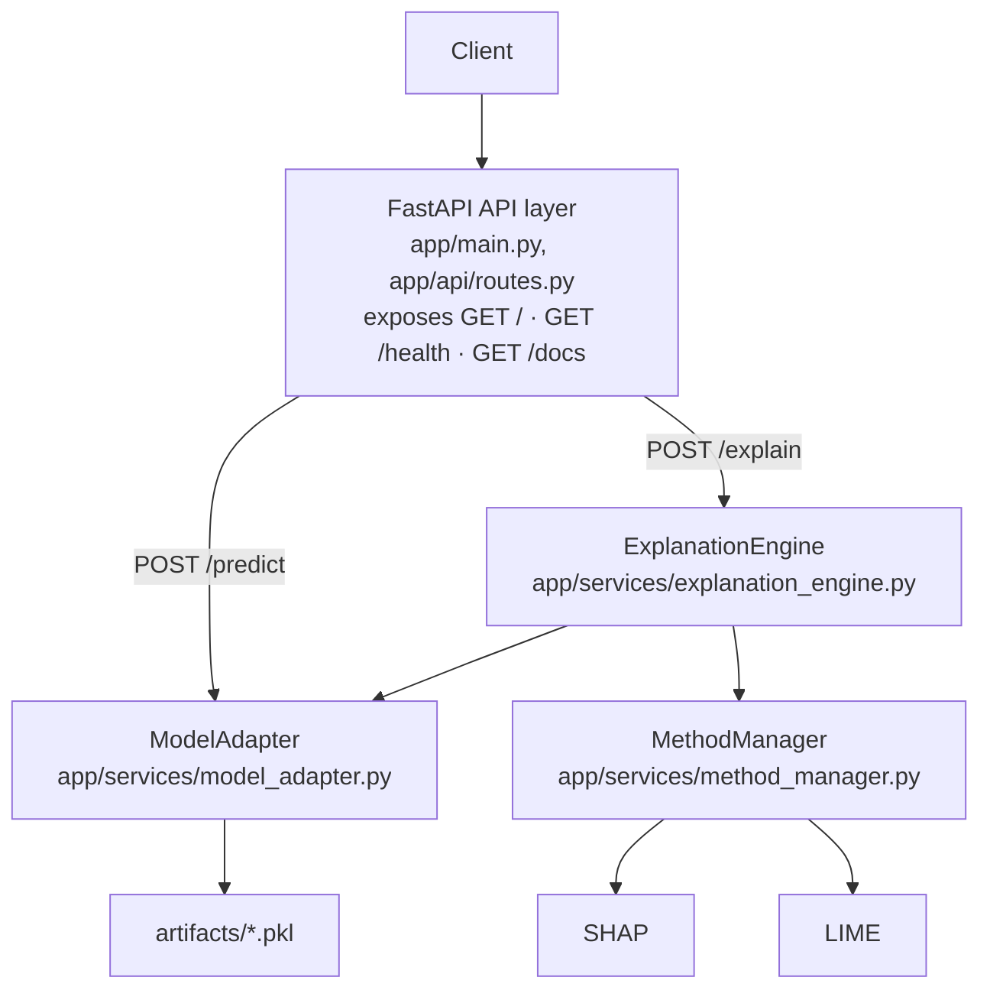

# Explainability-as-a-Service (EaaS)

*A contract-oriented reference implementation and empirical evaluation of explainability as a microservice — MSc Software Engineering thesis.*

**Thesis title:** Explainability-as-a-Service (EaaS): Operationalizing Explainable AI as a Cloud-Native, Model-Driven Microservice

**Repository:** [github.com/koaladroid/eaas](https://github.com/koaladroid/eaas) · **Branch:** [`cursor/validation-and-docker`](https://github.com/koaladroid/eaas/tree/cursor/validation-and-docker)

This repository contains a frozen FastAPI prototype that exposes prediction and post-hoc explanation through stable JSON contracts, together with recorded E1–E4 evidence. The contribution is **architectural and evaluative**: a lightweight, contract-oriented EaaS reference implementation and its empirical evaluation. The work does **not** claim to have invented Explainability-as-a-Service, does **not** introduce a new XAI algorithm, and does **not** claim production-grade deployment.

| | |
|---|---|
| **Implementation** | `random_forest` / `logistic_regression`; SHAP / LIME; fixed 30-feature Breast Cancer schema |
| **Recorded evaluation** | E1 120/120 contract-valid; E2 800/800 measured HTTP 200; E3 source inspection; E4 18/18 HTTP 422 |
| **Explicit limits** | Named artifacts only; `MethodManager` still depends on the model object and training data; E2 is sequential client latency, not throughput |

Production architecture, API contracts, models, explanation backends, and evaluation evidence are in a **development freeze**.

---

## Table of contents

- [Project overview](#project-overview)
- [Research context and objectives](#research-context-and-objectives)
- [System architecture](#system-architecture)
- [Technology stack](#technology-stack)
- [Supported models and explanation methods](#supported-models-and-explanation-methods)
- [API documentation](#api-documentation)
- [Project structure](#project-structure)
- [Evaluation snapshot](#evaluation-snapshot)
- [Evaluation methodology](#evaluation-methodology)
- [Evaluation results](#evaluation-results)
- [Limitations](#limitations)
- [Installation and local execution](#installation-and-local-execution)
- [Docker and deployment](#docker-and-deployment)
- [Research contribution](#research-contribution)
- [Repository and evaluation evidence](#repository-and-evaluation-evidence)

---

## Project overview

In this project, **Explainability-as-a-Service** is a small HTTP microservice that exposes model inference and post-hoc explanations through stable JSON contracts. A client sends a feature vector and a named model/method pair; the service returns a prediction together with a normalized feature-contribution map. The prototype is intended for academic inspection, not as a general-purpose MLOps platform.

The problem addressed is operational rather than algorithmic. In many applications, SHAP or LIME is invoked inside the same code path as the model. That coupling makes it harder to treat explanation as a reusable capability: clients must know which explainer to call, how to load a given model, and how to interpret method-specific objects. This prototype separates **prediction** from **explainability orchestration** so that both operations are reached through dedicated API endpoints and internal components.

Separating those concerns is useful in a software-engineering sense:

- the HTTP layer can validate requests and format responses without embedding explainer code;
- a single orchestration component can assemble a unified `/explain` response;
- model loading and prediction can sit behind one adapter;
- SHAP and LIME can be selected behind one method manager and still return the same JSON keys.

The research focus is therefore **software architecture**: service boundaries, interface contracts, dependency direction, and a controlled empirical case study (compatibility, latency, invalid-input handling, and source inspection). Service-oriented XAI already exists in the literature; this repository is a compact, inspectable reference implementation of that idea.

---

## Research context and objectives

**Primary research question** (from [`EVALUATION_GUIDELINES.md`](EVALUATION_GUIDELINES.md)):

> How can explainability be operationalized as a reusable service rather than being tied to an individual application or model?

The motivation is to show, in a frozen prototype, that explainability can be reached through `POST /explain`, that heterogeneous explainers can share one response schema, that orchestration can be centralized, and that more than one sklearn model can use the same explanation path.

Three layers should be kept distinct:

| Layer | What it is in this project | What it is not |
|---|---|---|
| **XAI techniques** | SHAP (`TreeExplainer` / `LinearExplainer`) and LIME (`LimeTabularExplainer`) as existing libraries | A claim that one method is more faithful, fair, or accurate than the other |
| **Software architecture** | FastAPI → `ExplanationEngine` → `ModelAdapter` + `MethodManager` | A universal model registry or plugin marketplace |
| **Service / API integration** | JSON HTTP contracts (`/predict`, `/explain`, `/health`, `/`) | An identity, billing, or multi-tenant cloud product |

Objectives of the frozen system and evaluation:

1. Provide a contract-oriented `/explain` interface used by both SHAP and LIME.
2. Route explanation work through `ExplanationEngine` rather than through the HTTP handlers.
3. Support two named models (`random_forest`, `logistic_regression`) on the sklearn Breast Cancer 30-feature schema.
4. Evaluate compatibility (E1), sequential client-observed latency (E2), architectural boundaries (E3), and invalid-input rejection (E4).

Out of evaluation scope: explanation quality, fidelity, fairness, SHAP-versus-LIME superiority, production scalability, and enterprise MLOps.

---

## System architecture

The implemented explanation path is:

`Client → FastAPI (`POST /explain`) → ExplanationEngine → ModelAdapter + MethodManager → SHAP or LIME`.

`POST /predict` is a **separate prediction path**. It calls `ModelAdapter` directly and does **not** go through `ExplanationEngine`. That is an observed design choice, not an `/explain` orchestration failure.



### Component responsibilities

| Component | Location | Responsibility |
|---|---|---|
| **FastAPI API layer** | `app/main.py`, `app/api/routes.py` | HTTP transport, Pydantic/enum validation, OpenAPI (`/docs`), error envelope formatting. `/explain` delegates to `ExplanationEngine`. `/predict` instantiates `ModelAdapter` and calls `predict` / `predict_proba`. |
| **ExplanationEngine** | `app/services/explanation_engine.py` | Orchestrates one explanation: construct adapter, obtain prediction and probability, call `MethodManager.explain`, merge `{model, prediction, probability}` with `{method, feature_importance}`. No HTTP, SHAP, LIME, or pickle I/O. |
| **ModelAdapter** | `app/services/model_adapter.py` | Loads a named joblib artifact, reshapes a length-30 vector, returns class label and predicted-class probability, and exposes training data / feature names. |
| **MethodManager** | `app/services/method_manager.py` | Selects `shap` or `lime`, runs the corresponding explainer, and returns a normalized `{method, feature_importance}` map sorted by descending absolute contribution. |
| **SHAP** | used only inside `MethodManager._run_shap` | `TreeExplainer` for `RandomForestClassifier`, `LinearExplainer` for `LogisticRegression`, otherwise `shap.Explainer`. |
| **LIME** | used only inside `MethodManager._run_lime` | `LimeTabularExplainer` on `X_train`, with `model.predict_proba` and `num_features` equal to the dataset feature count. |

### Dependency relationships and limits

- `app/main.py` imports only the API router (plus FastAPI/Starlette exception handling).
- `app/api/routes.py` imports `ExplanationEngine` and `ModelAdapter`. It does not import `shap` or `lime`.
- `ExplanationEngine` imports `ModelAdapter` and `MethodManager` only.
- `ModelAdapter` uses `joblib` and `numpy`. It maps two string names to two pickle files and hard-codes **30** features.
- `MethodManager` imports `shap`, `lime`, and sklearn classifier types. It reads `model_adapter.model` and `get_training_data()`. It is therefore **not** independent of the underlying model object or training matrix.

Serialized artifacts live under `artifacts/` (`random_forest.pkl`, `logistic_regression.pkl`, `training_data.pkl`). Feature names follow the sklearn Breast Cancer dataset order.

---

## Technology stack

Declared production dependencies are **unpinned** in [`requirements.txt`](requirements.txt). Versions below are those named in repository files, not a claim that a specific PyPI release is locked.

| Technology | Role | Version evidence |
|---|---|---|
| Python | Runtime | Docker base `python:3.12-slim`. Local evaluation clients recorded CPython **3.14.4**. Application code does not pin a language version. |
| FastAPI | HTTP application | `requirements.txt`; `app/main.py` sets `version="1.0.0"` |
| Uvicorn | ASGI server | `requirements.txt`; Docker `CMD` uses `python -m uvicorn app.main:app --host 0.0.0.0 --port 8000` |
| Pydantic | Request/response models | Imported in `app/api/routes.py` (transitive FastAPI dependency; not listed separately in `requirements.txt`) |
| Starlette | Request type / exception handling | Imported in `app/main.py` |
| scikit-learn | Models and Breast Cancer dataset | `requirements.txt`; `RandomForestClassifier`, `LogisticRegression` |
| NumPy | Arrays and SHAP/LIME inputs | `requirements.txt` |
| joblib | Artifact load/save | `requirements.txt` |
| SHAP | Explanation backend | `requirements.txt` |
| LIME | Explanation backend | `requirements.txt` |
| pandas | Listed in `requirements.txt` | **Not imported** by any application module inspected under `app/` |
| pytest, httpx | Tests and evaluation HTTP client | [`requirements-dev.txt`](requirements-dev.txt) |
| Docker | Container image | [`Dockerfile`](Dockerfile) |

There is no `docker-compose` file, no Kubernetes manifests, and no Railway configuration file in this repository.

---

## Supported models and explanation methods

| Kind | Supported values |
|---|---|
| Models | `random_forest`, `logistic_regression` |
| Methods | `shap`, `lime` |

The current prototype uses the **sklearn Breast Cancer Wisconsin** dataset (`load_breast_cancer` in `app/models/train.py`) with a **fixed 30-feature numerical input schema**. Feature order is the dataset order (mean radius, mean texture, …, worst fractal dimension). `X_test` in `artifacts/training_data.pkl` has shape **114 × 30**.

The service does **not** accept arbitrary model uploads, arbitrary feature names, or variable-length schemas. `ModelAdapter` is a named-artifact loader for the two pickled classifiers, not a universal model runtime.

Both explanation methods are required to return the same `/explain` keys: `model`, `method`, `prediction`, `probability`, `feature_importance`. Contribution **values** are not required to match across methods or across LIME repeats.

---

## API documentation

Interactive OpenAPI/Swagger UI is served at **`/docs`** when the application is running (also advertised in `GET /`). The contracts below match `app/main.py` and `app/api/routes.py`.

Documented error envelope (all mapped errors):

```json
{
  "error": {
    "type": "ValidationError",
    "message": "Invalid request body."
  }
}
```

Handlers in `_error_response` can also emit `InvalidModelError` and `InvalidMethodError` as HTTP **400** if a `ValueError` with those messages reaches the route. On `/explain`, unsupported `model` / `method` values are **enum fields**, so FastAPI/Pydantic typically reject them first as HTTP **422** `ValidationError` (`Invalid request body.`). E4 recorded that behaviour (see [Evaluation results](#evaluation-results)).

### `GET /`

**Purpose:** Service metadata.

**Request:** none.

**Example response:**

```json
{
  "service": "Explainability-as-a-Service (EaaS)",
  "version": "1.0.0",
  "docs": "/docs"
}
```

### `GET /health`

**Purpose:** Liveness-style health check (does not load models or run explainers).

**Request:** none.

**Example response:**

```json
{
  "status": "ok",
  "service": "Explainability-as-a-Service",
  "version": "1.0.0"
}
```

### `POST /predict`

**Purpose:** Class prediction and predicted-class probability. Implemented via `ModelAdapter` only.

**Query parameter:** `model` — required; `random_forest` or `logistic_regression`.

**Body:** JSON object with `features`: a list of **exactly 30** floats (`min_length=30`, `max_length=30`).

**Constraints:** Non-numeric items, missing `features`, or a length other than 30 are rejected by request validation (HTTP 422 `ValidationError` in the observed handler). An unknown `model` query value is likewise outside `ModelEnum`.

**Example request** (vector is `X_test[0]` from `artifacts/training_data.pkl`):

```bash
curl -X POST "http://127.0.0.1:8000/predict?model=random_forest" \
  -H "Content-Type: application/json" \
  -d "{\"features\": [19.55, 28.77, 133.6, 1207.0, 0.0926, 0.2063, 0.1784, 0.1144, 0.1893, 0.06232, 0.8426, 1.199, 7.158, 106.4, 0.006356, 0.04765, 0.03863, 0.01519, 0.01936, 0.005252, 25.05, 36.27, 178.6, 1926.0, 0.1281, 0.5329, 0.4251, 0.1941, 0.2818, 0.1005]}"
```

**Example success schema:**

```json
{
  "model": "random_forest",
  "prediction": 0,
  "probability": 1.0
}
```

`prediction` is an integer class label; `probability` is the probability of that predicted class (`ModelAdapter.predict_proba`).

### `POST /explain`

**Purpose:** Prediction plus a standardized feature-importance explanation. Delegates to `ExplanationEngine.generate_explanation`.

**Body (`ExplainRequest`):**

| Field | Type | Constraint |
|---|---|---|
| `model` | enum | `random_forest` or `logistic_regression` |
| `method` | enum | `shap` or `lime` |
| `input_data` | `list[float]` | exactly 30 numeric values, Breast Cancer feature order |

**Example request** (same `X_test[0]` vector):

```bash
curl -X POST "http://127.0.0.1:8000/explain" \
  -H "Content-Type: application/json" \
  -d "{\"model\": \"random_forest\", \"method\": \"shap\", \"input_data\": [19.55, 28.77, 133.6, 1207.0, 0.0926, 0.2063, 0.1784, 0.1144, 0.1893, 0.06232, 0.8426, 1.199, 7.158, 106.4, 0.006356, 0.04765, 0.03863, 0.01519, 0.01936, 0.005252, 25.05, 36.27, 178.6, 1926.0, 0.1281, 0.5329, 0.4251, 0.1941, 0.2818, 0.1005]}"
```

**Example success response** recorded in E1 (sample index 0, `random_forest` + `shap`). `feature_importance` contains **30** entries; the block below lists the first few keys as stored (sorted by descending absolute value) and marks the remainder as omitted for readability:

```json
{
  "model": "random_forest",
  "method": "shap",
  "prediction": 0,
  "probability": 1.0,
  "feature_importance": {
    "worst concave points": 0.0939898161429568,
    "worst area": 0.08109447529100106,
    "worst radius": 0.055731161709292765,
    "mean concave points": 0.05514700419162046
  }
}
```

`feature_importance` in a live response is a complete 30-key object; do not send a truncated map as a request. LIME uses the same keys and types; numeric values may differ and may vary across LIME runs.

---

## Project structure

Verified paths (caches and virtual environments omitted):

```
app/
  main.py                         # FastAPI app, GET /, GET /health, 422 handler
  api/routes.py                   # POST /predict, POST /explain
  services/
    explanation_engine.py
    model_adapter.py
    method_manager.py
  models/train.py                 # artifact generation (do not retrain for E1–E4)
artifacts/
  random_forest.pkl
  logistic_regression.pkl
  training_data.pkl
evaluation/
  README.md
  config.py
  scripts/
    run_e1_contract.py
    run_e2_performance.py
    run_e4_invalid_inputs.py
  results/raw/                    # JSONL evidence
  results/summaries/              # derived JSON summaries
  results/figures/                # placeholder only
  fixtures/                       # placeholder only
  architecture-audit/             # placeholder only (no E3 write-up file)
tests/
  test_health.py
  test_api_explain.py
  test_explanation_engine.py
  test_model_adapter.py
  test_method_manager.py
docs/                             # architecture, contracts, validation notes
Dockerfile
.dockerignore
requirements.txt
requirements-dev.txt
EVALUATION_GUIDELINES.md          # authoritative E1–E4 protocol
README.md
```

---

## Evaluation snapshot

Recorded HTTP experiments targeted `https://eaas-production-df33.up.railway.app/`. The deployed Git revision is **unverified**. Protocol and detailed tables follow in the next two sections.

| Experiment | What was measured | Observation (frozen evidence) |
|---|---|---|
| **E1** | Response contract on 120 valid `POST /explain` requests (4 combinations × 30) | 120/120 HTTP 200 and 120/120 contract-valid |
| **E2** | Sequential client-observed latency; 800 measured attempts (2 sessions × 4 × 100), warm-up excluded | E2: 800/800 measured attempts returned HTTP 200; 200 observations per model–method combination were used for pooled latency statistics. |
| **E3** | Source inspection of the five architectural files | Completed qualitative inspection; **no** separate audit file in `evaluation/architecture-audit/` |
| **E4** | 18 invalid `POST /explain` bodies (6 categories × 3) | 18/18 rejected with HTTP 422 `ValidationError`; 6 documented-type mismatches on E4.1 and E4.2 |

Contribution and limits remain as stated above: this is a reference implementation and case study, not a new explainer and not a scalability benchmark.

---

## Evaluation methodology

Authoritative protocol: [`EVALUATION_GUIDELINES.md`](EVALUATION_GUIDELINES.md). HTTP experiments call the **running** service `POST /explain`. They must not import SHAP or LIME in the evaluation process except through that API. Existing `tests/` are unit/API checks; they are **not** the E1–E4 protocol.

Evaluation HTTP target used in the recorded runs:

`https://eaas-production-df33.up.railway.app/`

Local git HEAD recorded in those summaries: `3be1dd352c9333342b7f7da08d2a80ca33358f02`. The **deployed Git revision is unverified**.

Combinations for E1 and E2:

1. `random_forest` + `shap`
2. `random_forest` + `lime`
3. `logistic_regression` + `shap`
4. `logistic_regression` + `lime`

### E1 — Model–method compatibility and response contract

| Item | Protocol value |
|---|---|
| Inputs | First 30 rows of `X_test` (`X_test[0:30]`), identical for every combination |
| Per combination | 30 requests |
| Total | **120** valid `POST /explain` requests |
| Checks | HTTP 200; keys `model`, `method`, `prediction`, `probability`, `feature_importance`; echoed model/method; integer prediction; probability in `[0, 1]`; 30 finite numeric importance entries; same schema across combinations |

SHAP and LIME values are not required to be equal.

### E2 — Runtime performance

| Item | Protocol value |
|---|---|
| Sessions | **2**, at least 30 minutes apart |
| Warm-up | **10** requests per combination per session (`X_test[0:10]`), **excluded** from statistics |
| Measured | **100** attempts per combination per session on `X_test[10:110]` |
| Measured total | **800** attempts |
| Client | Sequential HTTP, **120 s** timeout, **no retries**, no parallel load |
| Latency | Client-observed `time.perf_counter()` on measured HTTP **200** only; P95 = `np.percentile(..., 95, method="linear")` |
| Failures | Timeouts, connection errors, and non-200 statuses remain in the 100-attempt denominator |

This measures **sequential, end-to-end, client-observed API latency**. It does not measure throughput, concurrency, scalability, or isolated explainer time.

### E3 — Architectural evaluation

E3 is a **completed source-code architectural inspection** of the five files listed in the guidelines: `app/main.py`, `app/api/routes.py`, `app/services/explanation_engine.py`, `app/services/model_adapter.py`, and `app/services/method_manager.py`. It records separation of responsibilities and import/call-flow boundaries. It is **not** a runtime architectural benchmark.

**Evidence location:** findings are reported in this README (and earlier V3 notes in `docs/VALIDATION_RESULTS.md` are not a substitute for E1–E4). **No separate E3 audit document** is stored under `evaluation/architecture-audit/` (that directory contains only a `.gitkeep` placeholder).

### E4 — Invalid input handling

Six categories × three repetitions = **18** `POST /explain` attempts:

| ID | Category |
|---|---|
| E4.1 | Unsupported model |
| E4.2 | Unsupported method |
| E4.3 | Incorrect feature count (29 values) |
| E4.4 | Non-numeric feature |
| E4.5 | Missing required `input_data` |
| E4.6 | Malformed JSON body |

The protocol records observed status and body, then compares them with the **documented** error types. Mismatches are deviations, not silent passes. Only HTTP **4xx** counts as client-input rejection.

---

## Evaluation results

Figures below are **observations** from the frozen summary JSON files (and, for combined E2 latency, the matching raw JSONL). Interpretations are labelled separately.

### E1 (observation)

Source: [`evaluation/results/summaries/e1_contract_20261102_204631.json`](evaluation/results/summaries/e1_contract_20261102_204631.json)

| Metric | Value |
|---|---|
| Execution | `completed`, `fully_successful` |
| Planned / completed attempts | 120 / 120 |
| HTTP 200 | **120 / 120** |
| Contract-valid responses | **120 / 120** |
| Per combination | 30 / 30 HTTP 200 and contract-valid for all four pairs |

### E2 (observation)

Sources (summaries for per-session tables; raw JSONL for combined pooling):

- [`evaluation/results/summaries/e2_performance_session1_20261104_190239.json`](evaluation/results/summaries/e2_performance_session1_20261104_190239.json)
- [`evaluation/results/summaries/e2_performance_session2_20261104_194102.json`](evaluation/results/summaries/e2_performance_session2_20261104_194102.json)
- [`evaluation/results/raw/e2_performance_session1_20261104_190239.jsonl`](evaluation/results/raw/e2_performance_session1_20261104_190239.jsonl)
- [`evaluation/results/raw/e2_performance_session2_20261104_194102.jsonl`](evaluation/results/raw/e2_performance_session2_20261104_194102.jsonl)

Both sessions completed 400/400 measured HTTP 200 responses (800/800 measured attempts overall). Session 2 started 2140 s after session 1 ended (minimum required gap: 1800 s). Warm-up rows are excluded from the tables.

**Combined latency by combination.** Each combination has **200 measured HTTP 200 observations: 100 from session 1 and 100 from session 2**. Per-session summaries do not include a pooled table. Combined mean, median, and P95 were **recomputed from the preserved raw JSONL records** (measured phase, HTTP 200 only; P95 = NumPy `linear`). Raw JSONL files were not modified. The numerical results below are unchanged from the previously verified figures.

| Combination | n | Mean (ms) | Median (ms) | P95 (ms) |
|---|---:|---:|---:|---:|
| `random_forest` + `shap` | 200 | 356.72 | 347.79 | 391.38 |
| `random_forest` + `lime` | 200 | 424.08 | 411.15 | 515.90 |
| `logistic_regression` + `shap` | 200 | 319.49 | 312.80 | 333.10 |
| `logistic_regression` + `lime` | 200 | 376.37 | 367.11 | 407.61 |

**Session 1** (from the summary file; n = 100 HTTP 200 per combination):

| Combination | Mean (ms) | Median (ms) | P95 (ms) |
|---|---:|---:|---:|
| `random_forest` + `shap` | 353.76 | 343.61 | 385.34 |
| `random_forest` + `lime` | 426.99 | 412.97 | 524.99 |
| `logistic_regression` + `shap` | 320.96 | 310.49 | 344.30 |
| `logistic_regression` + `lime` | 366.02 | 361.67 | 407.61 |

**Session 2** (from the summary file; n = 100 HTTP 200 per combination):

| Combination | Mean (ms) | Median (ms) | P95 (ms) |
|---|---:|---:|---:|
| `random_forest` + `shap` | 359.69 | 352.01 | 391.38 |
| `random_forest` + `lime` | 421.16 | 410.38 | 485.53 |
| `logistic_regression` + `shap` | 318.02 | 315.30 | 327.55 |
| `logistic_regression` + `lime` | 386.72 | 368.72 | 400.52 |

**Interpretation (not a scalability result):** under sequential load against the recorded Railway URL, all 800 measured attempts returned HTTP 200. LIME combinations were slower than SHAP combinations in these sessions. These numbers describe client-observed end-to-end API latency only.

### E3 (completed source-code architectural inspection)

No numeric score is assigned. E3 is a completed qualitative inspection of the five frozen architectural files. **No separate E3 audit document** is stored in `evaluation/architecture-audit/` (that directory contains only a `.gitkeep` placeholder). The inspection is consistent with the following:

- The API layer handles HTTP and validation. `/explain` calls only `ExplanationEngine.generate_explanation`. It does not import SHAP or LIME.
- `ExplanationEngine` sequences `ModelAdapter` and `MethodManager` and does not perform HTTP, explainer execution, or pickle I/O.
- `ModelAdapter` loads the two named artifacts, predicts, and exposes training data/feature names through one class.
- `MethodManager` is the only module that imports SHAP and LIME; it normalizes both backends to `{method, feature_importance}`.
- `/predict` depends on `ModelAdapter` without `ExplanationEngine`. That is the dedicated prediction endpoint, not the explanation workflow.
- Residual coupling remains: `MethodManager` inspects concrete sklearn types and uses the live model object plus `X_train`.

Earlier validation notes in [`docs/VALIDATION_RESULTS.md`](docs/VALIDATION_RESULTS.md) (V3, dated 2026-09-08) are preliminary relative to E1–E4 and are **not** a substitute for this inspection.

### E4 (observation)

Source: [`evaluation/results/summaries/e4_invalid_inputs_20261102_211901.json`](evaluation/results/summaries/e4_invalid_inputs_20261102_211901.json)

| Metric | Value |
|---|---|
| Attempts | 18 / 18 completed |
| Rejected as HTTP 4xx | **18 / 18** |
| HTTP status | **422** for all 18 |
| HTTP 5xx | 0 |
| Unexpected HTTP 200 | 0 |
| Observed error type | `ValidationError` (`Invalid request body.`) |
| Inferred layer | Pydantic (request validation), all 18 |

**Documented type versus observed type:**

| Case | Documented type | Observed type | Matches (of 3) |
|---|---|---|---:|
| E4.1 unsupported model | `InvalidModelError` | `ValidationError` | 0 |
| E4.2 unsupported method | `InvalidMethodError` | `ValidationError` | 0 |
| E4.3 incorrect feature count | `ValidationError` | `ValidationError` | 3 |
| E4.4 non-numeric feature | `ValidationError` | `ValidationError` | 3 |
| E4.5 missing `input_data` | `ValidationError` | `ValidationError` | 3 |
| E4.6 malformed JSON | `ValidationError` | `ValidationError` | 3 |

**Six mismatches:** the six E4.1 and E4.2 attempts (3 + 3). Enum validation rejects unsupported `model` / `method` as HTTP 422 `ValidationError` before the service-layer 400 handlers that would emit `InvalidModelError` / `InvalidMethodError`. E4.3–E4.6 match the documented `ValidationError` type.

**Interpretation:** invalid bodies were consistently rejected and never returned an explanation. The written custom error types for unknown model/method are not what the live `/explain` enum path returns.

---

## Limitations

- Only two model types are supported (`random_forest`, `logistic_regression`).
- Only SHAP and LIME are supported.
- Input is a fixed 30-feature Breast Cancer vector; there is no schema registry or arbitrary-model upload.
- `ModelAdapter` is a named joblib loader, not a universal model adapter.
- `MethodManager` retains dependencies on the concrete model object, sklearn class checks, and serialized training data.
- E2 measures sequential client-observed end-to-end API latency. It does **not** measure throughput, concurrency, scalability, or high availability.
- The Railway deployed Git revision has **not** been independently verified.
- E3 is source-code structural inspection, not a runtime architectural benchmark.
- Production Python package versions are unpinned; evaluation clients recorded selected resolved versions (`httpx` 0.28.1, `joblib` 1.5.3, `numpy` 2.4.4) rather than a locked production image digest.
- `pandas` is declared in `requirements.txt` but is unused by application modules.
- LIME is stochastic; repeated explanations need not be numerically identical.
- Dockerfile `CMD` binds port **8000** and does not read `$PORT`.
- `.dockerignore` excludes `docs/`, `tests/`, and Markdown files from the image; the image copies only `app/` and `artifacts/`.

---

## Installation and local execution

Prerequisites observed from the repository:

- Python 3 (Docker image uses 3.12; a local 3.14.4 interpreter was used for evaluation clients)
- `pip`
- Repository contents including `artifacts/` (required at runtime)

From the repository root:

```bash
pip install -r requirements.txt
python -m uvicorn app.main:app --reload
```

The committed pickles under `artifacts/` are sufficient to start the service. **Do not run** `python app/models/train.py` as part of reproducing E1–E4; the protocol forbids retraining.

When the server is listening on the default host:

- OpenAPI UI: [http://127.0.0.1:8000/docs](http://127.0.0.1:8000/docs)
- Health: `curl http://127.0.0.1:8000/health`

Unit/API tests (not E1–E4):

```bash
pip install -r requirements-dev.txt
pytest
```

Evaluation scripts also require `httpx` from `requirements-dev.txt`. Live E1/E2/E4 commands are documented in [`evaluation/README.md`](evaluation/README.md) and should not be re-run against the frozen evidence files if the intent is only to inspect existing results.

---

## Docker and deployment

### Docker (verified in-repo)

[`Dockerfile`](Dockerfile):

- Base image: `python:3.12-slim`
- Installs `requirements.txt`
- Copies `app/` and `artifacts/` only
- Exposes port **8000**
- `CMD ["python", "-m", "uvicorn", "app.main:app", "--host", "0.0.0.0", "--port", "8000"]`

The image does **not** read `$PORT`. There is no Compose file in the repository. This is a single-process container, not a documented high-availability deployment.

Example (host port 8000):

```bash
docker build -t eaas .
docker run --rm -p 8000:8000 eaas
```

### Railway (evaluation target; platform config not in this repository)

HTTP experiments were executed against:

`https://eaas-production-df33.up.railway.app/`

Owner-confirmed in the evaluation guidelines: `GET /health` succeeds and `GET /docs` is accessible. Recorded E1/E2/E4 summaries use that base URL. **No Railway service file is present here.** The deployed Git commit and Railway Python/runtime version remain **unverified**. A successful local or Docker run does not by itself prove the public deployment’s revision.

This prototype is **not** described as production-grade.

---

## Research contribution

The contribution of this thesis is:

> A lightweight reference implementation that separates model adaptation, explanation-method management, and orchestration behind a standardized explanation API, evaluated through a controlled case study.

It is an **architectural implementation and empirical evaluation** contribution. SHAP and LIME are used as existing techniques. The work does not claim a new XAI algorithm, does not claim to have originated the EaaS idea, and does not claim production readiness, fairness guarantees, or explainer superiority.

What the frozen prototype and E1–E4 evidence support, within their stated limits:

- explainability is reachable through `POST /explain`;
- SHAP and LIME share one response schema on the evaluated requests;
- `ExplanationEngine` is the `/explain` orchestrator;
- both supported models use that same explanation path;
- invalid `/explain` bodies were rejected in E4, with documented-versus-observed error-type deviations recorded.

---

## Repository and evaluation evidence

| Item | Location |
|---|---|
| Evaluation protocol | [`EVALUATION_GUIDELINES.md`](EVALUATION_GUIDELINES.md) |
| How to run scripts | [`evaluation/README.md`](evaluation/README.md) |
| Experiment constants | [`evaluation/config.py`](evaluation/config.py) |
| E1 script | [`evaluation/scripts/run_e1_contract.py`](evaluation/scripts/run_e1_contract.py) |
| E2 script | [`evaluation/scripts/run_e2_performance.py`](evaluation/scripts/run_e2_performance.py) |
| E4 script | [`evaluation/scripts/run_e4_invalid_inputs.py`](evaluation/scripts/run_e4_invalid_inputs.py) |
| E1 raw JSONL | [`evaluation/results/raw/e1_contract_20261102_204631.jsonl`](evaluation/results/raw/e1_contract_20261102_204631.jsonl) |
| E1 summary | [`evaluation/results/summaries/e1_contract_20261102_204631.json`](evaluation/results/summaries/e1_contract_20261102_204631.json) |
| E2 session 1 raw / summary | [`evaluation/results/raw/e2_performance_session1_20261104_190239.jsonl`](evaluation/results/raw/e2_performance_session1_20261104_190239.jsonl) · [`evaluation/results/summaries/e2_performance_session1_20261104_190239.json`](evaluation/results/summaries/e2_performance_session1_20261104_190239.json) |
| E2 session 2 raw / summary | [`evaluation/results/raw/e2_performance_session2_20261104_194102.jsonl`](evaluation/results/raw/e2_performance_session2_20261104_194102.jsonl) · [`evaluation/results/summaries/e2_performance_session2_20261104_194102.json`](evaluation/results/summaries/e2_performance_session2_20261104_194102.json) |
| E4 raw / summary | [`evaluation/results/raw/e4_invalid_inputs_20261102_211901.jsonl`](evaluation/results/raw/e4_invalid_inputs_20261102_211901.jsonl) · [`evaluation/results/summaries/e4_invalid_inputs_20261102_211901.json`](evaluation/results/summaries/e4_invalid_inputs_20261102_211901.json) |
| Unit / API tests | [`tests/`](tests/) |
| Architecture and contracts (supporting docs) | [`docs/ARCHITECTURE.md`](docs/ARCHITECTURE.md), [`docs/API_CONTRACTS.md`](docs/API_CONTRACTS.md), [`docs/THESIS_CONTRIBUTION.md`](docs/THESIS_CONTRIBUTION.md) |

Repository: [https://github.com/koaladroid/eaas](https://github.com/koaladroid/eaas) (branch used for the freeze: `cursor/validation-and-docker`).
